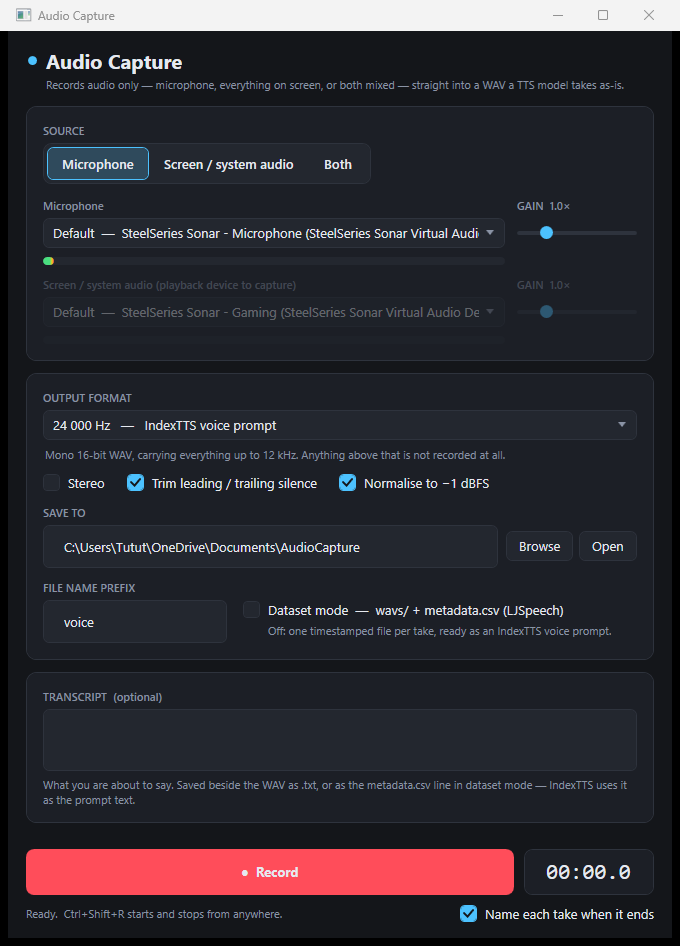

# Audio Capture

Records **audio only** — your mic, everything playing on your screen, or both mixed — and saves it
as a WAV that IndexTTS (or any other TTS / voice-cloning model) will take as-is.

**Double-click `Audio Capture.bat`.**



---

## Using it

1. Pick a source: **Microphone**, **Screen / system audio**, or **Both**.
   The bar under each device moves when there is sound, so you can check it before you commit.
2. Pick the format — see **Which sample rate** below. It matters more than anything else here.
3. Hit **Record**, then **Stop & save**.
4. A small window opens: **name the take**, hit **Play** to check it, or **Discard** it and go again.

**Ctrl+Shift+R** starts and stops from anywhere, even when the app is behind whatever you are
recording.

Files land in `Documents\AudioCapture` unless you change it.

## Which sample rate — read this one

Half the sample rate is a **hard ceiling** on what the file can contain. Nothing above it is
recorded, and no amount of trimming, normalising or re-saving brings it back.

| Preset | Ceiling | Use it for |
|---|---|---|
| **48 000 Hz** | 24 kHz | **Sound effects, music, game audio, anything off screen** |
| 44 100 Hz | 22 kHz | CD quality |
| **24 000 Hz** | 12 kHz | **IndexTTS voice prompts** |
| 22 050 Hz | 11 kHz | LJSpeech fine-tuning datasets |
| 16 000 Hz | 8 kHz | Whisper / speech recognition |

A voice lives below 8 kHz, so 24 kHz loses nothing that matters and keeps the file small — which is
why it is right for TTS. But the *sharpness* of a sound effect — the snap, the crack, the air — is
exactly the 12–20 kHz content that 24 kHz throws away. **Capturing a sound effect at 24 kHz will
sound dull compared to the source. Use 48 000 Hz.**

Tick **Stereo** for anything musical or off screen. Left and right get folded together otherwise,
and where the two channels disagree they cancel — what cancels first is the treble, so a mono
capture of a stereo effect loses width *and* brightness. Leave it off for voice: TTS wants mono.

## For a voice clone (one clip)

IndexTTS2 clones from a single reference clip. What it wants:

- **5 to 15 seconds** of clean speech, one speaker, no music underneath.
- Normal pace, normal volume, an ordinary sentence or two.
- No long silences — leave **Trim leading / trailing silence** ticked and it handles that.

Type what you said into the **Transcript** box and it gets saved as a `.txt` next to the WAV.
IndexTTS can use that as the prompt text.

> IndexTTS2 separates *timbre* from *delivery* — it takes the voice from one clip and the emotional
> performance from another. So record two: a neutral one for the voice, and a second one performed
> the way you want the output to sound.

## For a fine-tuning dataset (many clips)

Tick **Dataset mode**. Now each take is numbered into `wavs/` and its transcript is appended to
`metadata.csv` in LJSpeech format:

```
your-folder/
  metadata.csv        voice_0001|Hello there.|Hello there.
  wavs/
    voice_0001.wav
    voice_0002.wav
```

The loop is: type the line you are about to read into the Transcript box → record → stop. The box
clears itself, ready for the next line. Switch the preset to **22 050 Hz** if your training script
expects LJSpeech rates.

## Options

| | |
|---|---|
| **Stereo** | On for music and sound effects, off for voice. See above. |
| **Trim leading / trailing silence** | Cuts dead air from both ends, keeping 0.15 s of padding. Leave on. |
| **Normalise to −1 dBFS** | Brings a quiet recording up to a consistent level. Leave on. |
| **Gain** | Only needed in **Both** mode, to balance your voice against the system audio. |
| **File name prefix** | The starting name for each take, and the speaker name in a dataset. |
| **Name each take when it ends** | The window that opens after every take. Untick for rapid-fire capture. |

Neither trim nor normalise changes the **tone** of a recording — they only touch level and dead air
at the ends. If something sounds dull, it is the sample rate, not these.

Even with normalising off, a recording that would clip is turned down instead of clipped.

## Checking it works

`Self Test.bat` runs 67 checks against your actual sound card — it plays a quiet test tone, records
it back, and verifies the level, the sample rate and that the captured audio really is the tone.
Run it if a recording ever comes out wrong.

## Requirements

Windows and the [.NET 8 SDK](https://dotnet.microsoft.com/download). No virtual audio cable and no
"Stereo Mix" needed — system audio is captured through WASAPI loopback directly.
