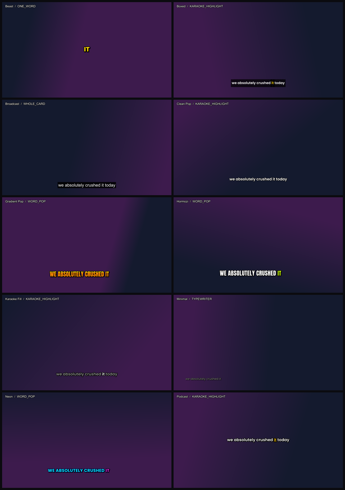

# SubtitleStudio

CapCut-style animated subtitles, generated automatically, running entirely on
your own PC. No account, no API key, no upload, no per-minute cost.



---

## Start here

1. Double-click **`INSTALL.bat`** — once, ever.
2. Double-click **`SubtitleStudio.bat`**.
3. Drop a video in. Press play — it plays with sound straight away.
4. Pick a style. Press **Generate subtitles**. Press **Export**.

The very first time you generate subtitles it downloads the speech model (about
3 GB) and shows you the megabytes as they arrive. That happens once.

## The window

**Player** — real playback with sound, at the video's own frame rate. Captions are
drawn live on top, so you can actually watch the timing.

**Timeline** — video thumbnails, the audio waveform, and a subtitle track showing
every caption. Click or drag anywhere to scrub. Scroll to zoom in.

**Style** — ten looks, each previewed on your own footage. Usable *before* you
transcribe: drop a video in, hit play, and try styles against a sample caption.

**Transcript** — follows along as it plays. Double-click a line to fix what it
misheard; right-click to split a card in two or merge it with the next.

**Four tabs**, all acting on whichever layer is selected:

| tab | what's in it |
|---|---|
| **Style** | the ten looks, and how words arrive |
| **Layout** | position, text size, words per line, distance from the edge, timing nudge |
| **Effects** | how the words move — see below |
| **Sound** | the caption sound and its volume |

## Effects

| | |
|---|---|
| **Preset** | None · Subtle · Default · Bouncy · Tilt · Fade in · Big |
| **Pop strength** | how far each word grows as it lands. 0 is perfectly still |
| **Pop speed** | how quickly it plays out — higher is snappier |
| **Tilt** | words arrive rotated by a few degrees and straighten as they settle |
| **Word fade in** | fade each word in instead of it appearing instantly |
| **Card fade** | fade the whole caption in and out at its edges |

The default is a gentle grow-and-settle (78% → 108% → 100% over 200 ms). Push
**Pop strength** up for a hard bounce, or down — or straight to **None** — if you
want captions that just sit there.

Everything here is baked into the export exactly as you see it in the preview:
both use the same curve.

## Layers

**Add** at the top of the style panel gives you a second caption track. Each layer
has its own style, motion, position, size and timing nudge, and gets its own row
on the timeline. Stack a Hormozi line along the bottom with a single big word up
top, and both are burned in together.

The dot on the left hides a layer without deleting it. **Copy** duplicates one so
you can offset it slightly — two copies a few hundredths apart makes a cheap
drop-shadow or echo.

## Style and motion are separate

Any look can have any motion:

| | |
|---|---|
| **Pop** | words appear one at a time and build up the line |
| **Karaoke** | the whole line sits there, the highlight travels across it |
| **One word** | one big word at a time, centred — the TikTok look |
| **Phrase** | two or three words at a time, swapping as a group |
| **Type** | words appear progressively, calmly, with no pop |
| **Plain** | ordinary captions, no animation |

## Caption sounds

Pick a sound under **Sound** and it plays as each caption appears — while you
preview, and mixed into the exported audio. Five are built in (pop, tick, blip,
thud, whoosh). **Add your own…** opens `assets\sfx` — drop any `.wav` or `.mp3`
in there and it appears in the list.

On *One word* it fires per word; on everything else, once per caption.

## Exporting

**Burn captions into the video** bakes them into the pixels. Plays anywhere,
can't be switched off, re-encodes on your GPU. All layers, and the caption
sounds, go in together.

**Subtitle file only** writes `.srt` / `.ass` next to your video and leaves the
video untouched. Takes about a second.

**Switchable subtitle track (.mkv)** keeps the full styling but lets a viewer turn
captions off, like a DVD. No re-encode, so it finishes in well under a second.
It has to be `.mkv` — MP4 can only carry plain text subtitles, which would throw
away every colour and animation, so the app changes the extension for you rather
than handing back a file that looks nothing like the preview.

## Speed vs quality

The dropdown next to **Generate subtitles** picks the speech model. *Best
quality* is `large-v3`. *Fast* is about 6x quicker with very similar English
accuracy. Each downloads once, the first time you choose it.

## Keyboard

| | |
|---|---|
| `Space` | play / pause |
| `←` `→` | step a second (hold `Shift` for a tenth) |
| `Home` `End` | jump to start / end |
| scroll on timeline | zoom in and out |

## Speed on your machine (RTX 4070 SUPER)

92 seconds of 1080p, from dropping it in to a finished burned-in export: about
**25 seconds**. Transcription runs at 12–21x realtime, the GPU encode at ~11x.

## About the preview

Playback draws captions with Qt so it can keep up with real video and sound. The
export is rendered by libass, which is what actually writes your file. The two
agree on *which* words show — that decision comes from one shared function — but
tiny typographic details can differ. The **Exact** button next to the volume
renders the current frame exactly the way the export will, when you want to be
certain.

## If something goes wrong

- **Two sets of captions when you play the exported video** — there's a `.ass` or
  `.srt` next to it with the same name, and your player is auto-loading it on top
  of the burned-in ones. Move or delete that file; the video itself is fine, no
  re-export needed. (Newer exports put subtitle files in a subfolder so this
  can't happen.)

- **"Could not locate cudnn_*.dll"** — the GPU library versions have to match.
  Re-run `INSTALL.bat`, and don't loosen the pins in `requirements.txt`.
- **A style doesn't look like the picture** — the fonts ship in `assets/fonts`.
  If they're missing the app falls back to Impact / Segoe UI and says so.

## Your work is saved

Every video gets a small `.subproj` file next to it holding the transcript and
your style. Reopen the video later and it comes straight back — it never
re-transcribes, and changing the style never touches the GPU.

## Not there yet

- Layers all caption the same speech — there's no separate translation track.
- No per-word manual retiming (drag a word's boundary); text and card breaks
  only.
- No keyframed movement — captions sit where the layer puts them.

---

## Without the window

```
Subtitle.bat                        drag a video onto it
.venv\Scripts\python subtitle.py myvideo.mp4 --theme beast --mode ONE_WORD
.venv\Scripts\python subtitle.py --list-themes
```

Useful flags: `--seconds 20`, `--no-burn`, `--max-words 3`, `--size 12`, `--cpu`,
`--retranscribe`, `--model distil-large-v3`.

## For developers

```
.venv\Scripts\python tests\test_core.py            65 unit tests, no GPU needed
.venv\Scripts\python tools\verify_app.py <video>   full end-to-end app test (49 checks)
.venv\Scripts\python tools\verify_no_shift.py      pixel-proves captions don't jitter
.venv\Scripts\python tools\verify_pop.py           measures the pop on screen
.venv\Scripts\python tools\screenshot.py <video> <dir>   drive the UI, capture every state
.venv\Scripts\python tools\contact_sheet.py        render every theme to one PNG
.venv\Scripts\python tools\make_sfx.py             regenerate the built-in sounds
```

`src/core/` has no Qt in it and `src/ui/` never shells out to ffmpeg.
Read `CLAUDE.md` for the map and the landmines, then `BUILD_PROMPT.md` §12.
